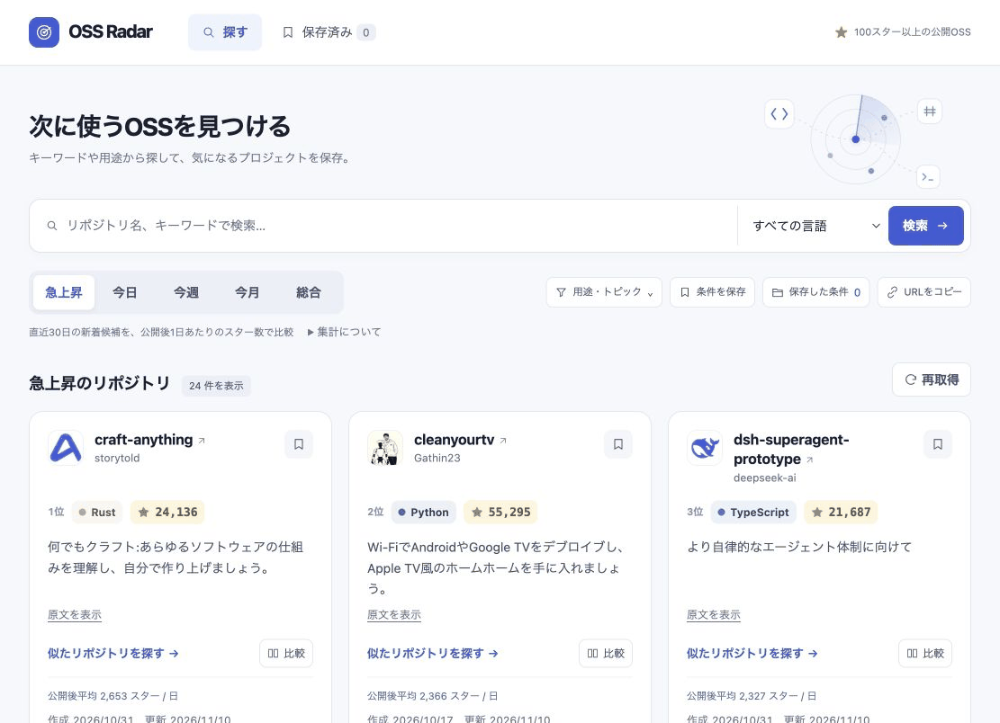
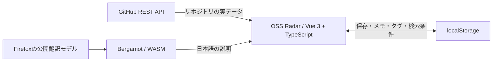

<p align="center">
  
</p>

<h1 align="center">GitHub OSS Radar</h1>

<p align="center">
  <strong>見つけて、比べて、自分の目録に。</strong><br />
  100スター以上のGitHubリポジトリを、日本語で見渡す探索ダッシュボード。
</p>

<p align="center">
  <a href="#preview">プレビュー</a> &nbsp; / &nbsp;
  <a href="#features">できること</a> &nbsp; / &nbsp;
  <a href="#quick-start">起動する</a> &nbsp; / &nbsp;
  <a href="#under-the-hood">仕組み</a>
</p>

<a id="preview"></a>

## 探索する楽しさを、ブラウザに。

キーワードが決まっていれば検索。まだ決まっていなければ、用途やトピックから。
気になるOSSを並べて比べ、次に試す候補を残せます。



<p align="center"><sub>実際の画面を記録したプレビュー · 白を基調にしたUIと、探索に動きを添えるレーダー</sub></p>

<a id="features"></a>

## 発見から、次に使う一本まで。

<table>
  <tr>
    <td width="33%" valign="top">
      <h3>01 / 見つける</h3>
      <p>キーワード・言語・トピックで絞り込み。14の用途から、知らなかったOSSへ。</p>
      <p><sub>5つのランキング / 日本語の説明 / 24件ずつ追加表示</sub></p>
    </td>
    <td width="33%" valign="top">
      <h3>02 / 比べる</h3>
      <p>気になる2〜3件を横並びに。スター数、言語、日付、ライセンスを見比べる。</p>
      <p><sub>取得済みデータで比較 / 追加API通信なし</sub></p>
    </td>
    <td width="33%" valign="top">
      <h3>03 / 残す</h3>
      <p>保存したOSSにメモとタグを。「試したい」「導入候補」を自分の言葉で整理。</p>
      <p><sub>ブックマーク / メモ / タグ / 検索条件の保存</sub></p>
    </td>
  </tr>
</table>

**探し方も、その続きも。** 検索条件をURLで共有でき、再読み込みや「戻る」でも条件を復元します。似た候補を見た後は、元の一覧の閲覧位置へ。「もっと見る」で追加したときも、読んでいた位置を保ちます。

<details>
<summary><strong>比較する — スペックを横に並べて選ぶ</strong></summary>

カードの「比較」から最大3件を選択し、画面下の「選択したOSSを比較」を押します。候補は一覧を切り替えても保持されます。狭い画面では表の中を横にスクロールできます。


</details>

<details>
<summary><strong>整理する — メモとタグで、自分の目録を育てる</strong></summary>

「保存済み」からメモとタグを編集し、タグで絞り込めます。メモは2,000文字、タグは8個まで、1個20文字以内。画面は入力例です。


</details>

<details>
<summary><strong>選んで探す — キーワードが浮かばないときに</strong></summary>

CLI、開発ツール、Web開発、機械学習、自動化など14の用途から選択。`terminal` や `markdown` など、任意のGitHubトピックも指定できます。カードから共通トピック・同じ言語の候補を探すこともできます。


</details>

<a id="quick-start"></a>

## まずは、動かしてみる。

**Node.js 22.12以降**とnpmを用意します。

```sh
git clone https://github.com/taku0193/github-oss-radar.git
cd github-oss-radar
npm ci
npm run dev
```

Viteが表示するローカルURLを開けば、探索を始められます。GitHub APIトークンや環境変数の設定は不要です。

| コマンド | 内容 |
| --- | --- |
| `npm run dev` | 開発サーバーを起動 |
| `npm test` | Vitestでテストを実行 |
| `npm run build` | TypeScriptの型チェックと本番ビルド |
| `npm run preview` | ビルドした画面をローカルで確認 |

<a id="under-the-hood"></a>

## ブラウザで完結する、小さな構成。

**Vue 3 · TypeScript · Vite · GitHub REST API · Vitest · localStorage**

GitHubの実データを直接取得し、説明の翻訳もブラウザ内で処理します。バックエンド、データベース、LLMは使用しません。



**保存先は、あなたのブラウザ。** アカウント登録は不要です。メモ・タグは共有URLに含みません。保存内容は端末間で自動同期されず、サイトデータの削除で失われます。

<details>
<summary><strong>ランキングの読み方</strong></summary>

対象は**100スター以上の公開リポジトリ**。フォークは除外し、日付は**日本時間**を基準にします。

| 表示 | 対象 | 並び順 |
| --- | --- | --- |
| **急上昇** | 直近30日間に作成されたスター数上位100件の候補 | 公開後1日あたりの平均スター数 |
| **今日** | 今日0時以降に作成 | 現在の累計スター数 |
| **今週** | 今週月曜日0時以降に作成 | 現在の累計スター数 |
| **今月** | 今月1日0時以降に作成 | 現在の累計スター数 |
| **総合** | 作成期間の制限なし | 現在の累計スター数 |

今日・今週・今月は「作成期間」のランキングです。期間中に増えたスター数は集計していません。

急上昇は `累計スター数 ÷ 公開日数（最低1日）` による目安です。最大100件の候補を並べ替えてから24件ずつ表示するため、追加表示で既存の順位は入れ替わりません。通常の検索はGitHub Search APIの上限である1,000件まで追加取得できます。

</details>

<details>
<summary><strong>APIの上限とエラー表示</strong></summary>

認証なしでGitHub REST APIへ接続します。APIトークンやクライアントシークレットはフロントエンドに埋め込みません。

- リポジトリ検索は**接続元IPごとに1分10回**。 [GitHub公式：検索の制限](https://docs.github.com/en/rest/search/search#rate-limit)
- 通常のREST APIは認証なしで**1時間60回**。検索には別の上限枠があります。 [GitHub公式：レート制限](https://docs.github.com/en/rest/using-the-rest-api/rate-limits-for-the-rest-api)

| 操作 | GitHub APIへのリクエスト |
| --- | ---: |
| 検索・ランキング切り替え・再取得 | 通常1回 |
| 似たリポジトリを探す | 1〜2回 |
| 通常ランキングの「もっと見る」 | 1回 |
| 急上昇の取得済み候補を追加表示 | 0回 |
| 比較・保存・メモ・タグ編集 | 0回 |

上限時は再試行できる時刻を案内し、連続送信を抑制します。通信エラー、検索結果0件、一部の結果だけ返された場合も画面で区別します。

</details>

<details>
<summary><strong>日本語訳とモーションについて</strong></summary>

説明文はBergamotとWebAssemblyでブラウザ内翻訳します。初回は翻訳モデルをダウンロードします。翻訳できない場合は原文を表示し、翻訳後も原文へ切り替えられます。

レーダーの走査線・点・タイルが動き、検索中はカード形のスケルトンを表示します。カードの登場、ランキングの選択、比較欄の開閉にはAstryxのモーション基盤を使用しています。OSの「動きを減らす」設定に対応し、装飾アニメーションは読み上げ対象から除いています。

</details>

## 開発する人へ。

機能単位のブランチで、**Red → Green → Refactor**。API通信はモックし、日付の境界・ランキング・比較上限・URL復元・ストレージの異常系をVitestで検証します。

<details>
<summary><strong>ソースコードの案内</strong></summary>

| 担当 | 主なファイル |
| --- | --- |
| API通信・検索条件・エラー | [`src/github.ts`](./src/github.ts) |
| 日本時間の期間・急上昇の目安 | [`src/rankings.ts`](./src/rankings.ts) |
| 検索条件・URL・保存した検索 | [`src/useSearchFilters.ts`](./src/useSearchFilters.ts)、[`src/searchPreferences.ts`](./src/searchPreferences.ts) |
| 比較・ブックマーク・メモ | [`src/comparison.ts`](./src/comparison.ts)、[`src/bookmarks.ts`](./src/bookmarks.ts)、[`src/bookmarkNotes.ts`](./src/bookmarkNotes.ts) |
| 日本語訳・翻訳Worker | [`src/translation.ts`](./src/translation.ts)、[`src/bergamot.ts`](./src/bergamot.ts) |
| カード・画面・スタイル | [`src/components`](./src/components)、[`src/App.vue`](./src/App.vue)、[`src/style.css`](./src/style.css) |

</details>

デザインの方針と参考サイトは[`DESIGN.md`](./DESIGN.md)に記録しています。

---

<p align="center"><strong>次に使うOSSに、出会おう。</strong></p>
<p align="center"><sub>Designed for discovery. Built with Vue.</sub></p>

<details>
<summary>デザイン基盤・謝辞</summary>

[Meta Astryx](https://github.com/meta/astryx)の時間尺度の生成関数、expressive曲線、Neutralテーマの角丸と影をVueのUIで利用しています。取り込み内容は[`src/astryx/NOTICE.md`](./src/astryx/NOTICE.md)、ライセンスは[`public/licenses/astryx.txt`](./public/licenses/astryx.txt)を参照してください。

Open DesignのWarm Editorialから取り込んだトークンのライセンスは[`public/licenses/open-design.txt`](./public/licenses/open-design.txt)に含めています。

</details>
