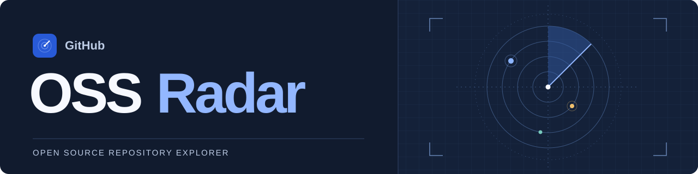
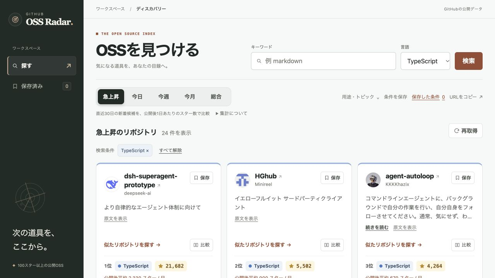
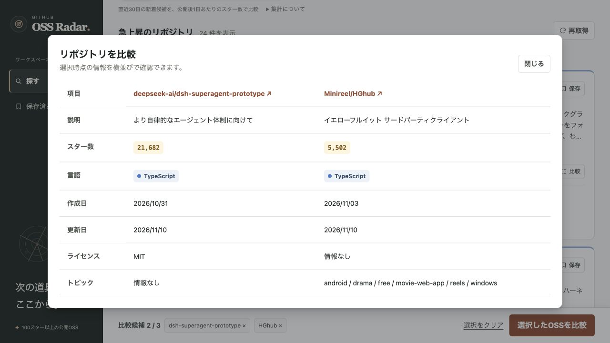
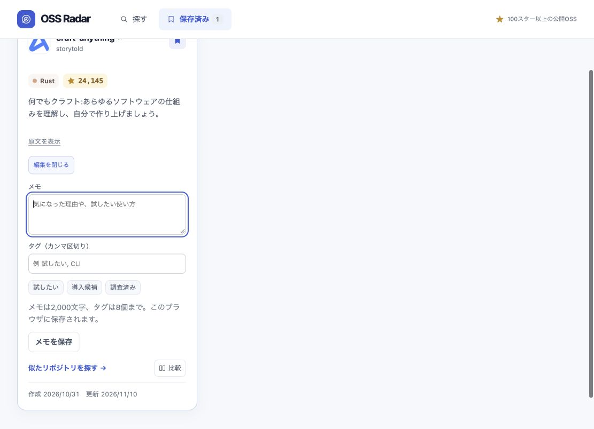
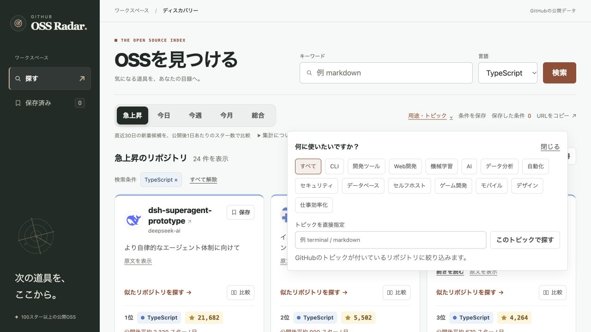
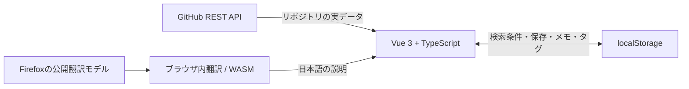

<p align="center">
  
</p>

<h1 align="center">GitHub OSS Radar</h1>

<p align="center">
  <strong>気になるOSSを見つけて、比べて、自分の目録に。</strong><br />
  100スター以上の公開リポジトリを、日本語で見渡せるダッシュボード。
</p>

<p align="center"><sub>VUE 3 &nbsp; / &nbsp; TYPESCRIPT &nbsp; / &nbsp; VITE &nbsp; / &nbsp; GITHUB REST API &nbsp; / &nbsp; VITEST</sub></p>

<p align="center">
  <a href="#クイックスタート">すぐに動かす</a> &nbsp; · &nbsp;
  <a href="#できること">できること</a> &nbsp; · &nbsp;
  <a href="#画面を見てみる">画面を見る</a> &nbsp; · &nbsp;
  <a href="#apiの上限">APIの上限</a>
</p>



> **バックエンド・データベース・LLMなし。** GitHubから取得した実データをブラウザで表示し、保存内容はlocalStorageで管理します。

## できること

| 見つける | 比べる | 自分の目録に残す |
| --- | --- | --- |
| 5種類のランキングで入口を選ぶ | 気になる2〜3件を横並びにする | ブックマークをブラウザに保存 |
| キーワード・言語・トピックで絞る | スター数・言語・日付・ライセンスを確認 | 「試したい」「導入候補」などのタグで整理 |
| 説明をブラウザ内で日本語に翻訳 | 取得済みデータで追加API通信なし | メモで選んだ理由や試した結果を残す |

- **用途から探す。** CLI、開発ツール、Web開発、機械学習、自動化など14の選択肢。任意のGitHubトピックも指定できます。
- **続きを見渡す。** 24件ずつ表示し、「もっと見る」で追加。長い説明は3行から展開できます。
- **探し方も保存する。** 名前を付けた検索条件を最大12件保存。再読み込みやブラウザの「戻る」でも条件を復元します。
- **検索画面を共有する。** ランキング・キーワード・言語・トピックをURLに含めて共有。メモやタグは共有URLに含みません。
- **似た候補へ進む。** カードから共通トピック・同じ言語の候補を探し、元の一覧の閲覧位置へ戻れます。
- **閲覧を続けやすく。** GitHubは別タブで開きます。カードは画面幅に応じて3列・2列・1列に切り替わります。
- **操作に動きで応える。** Astryxのモーション基盤を採用。カードが順に浮かび上がり、ランキングの選択面が移動し、比較欄は下からせり上がります。OSの動きを減らす設定にも対応します。

## 画面を見てみる

<details>
<summary><strong>比較 — リポジトリを並べて選ぶ</strong></summary>

カードの「比較」から最大3件を選び、画面下の「選択したOSSを比較」を押します。比較候補は一覧を切り替えても保持されます。ライセンスが取得できない場合は「情報なし」と表示します。



</details>

<details>
<summary><strong>目録 — メモとタグで使う候補を整理する</strong></summary>

「保存済み」でメモ・タグを編集し、タグで一覧を絞り込めます。メモは2,000文字、タグは8個まで、1個20文字以内。画面はメモとタグの入力例です。



</details>

<details>
<summary><strong>用途 — キーワードが浮かばなくても探せる</strong></summary>

「用途・トピック」から選択するか、`terminal` や `markdown` などのトピックを直接指定します。選択したトピックが付いているリポジトリが対象です。



</details>

## クイックスタート

**Node.js 22.12以降**とnpmを用意します。

```sh
git clone https://github.com/taku0193/github-oss-radar.git
cd github-oss-radar
npm ci
npm run dev
```

Viteが表示したローカルURLを開きます。GitHub APIトークンや環境変数の設定は不要です。

```sh
npm test          # Vitestで検証
npm run build    # 型チェック + 本番ビルド
npm run preview  # ビルドした画面を確認
```

## ランキングの読み方

対象は**100スター以上の公開リポジトリ**。フォークは検索対象から除きます。

| 表示 | 対象 | 並び順 |
| --- | --- | --- |
| **急上昇** | 直近30日間に作成されたスター数上位100件の候補 | 公開後1日あたりの平均スター数 |
| **今日** | 今日0時以降に作成 | 現在の累計スター数 |
| **今週** | 今週月曜日0時以降に作成 | 現在の累計スター数 |
| **今月** | 今月1日0時以降に作成 | 現在の累計スター数 |
| **総合** | 作成期間の制限なし | 現在の累計スター数 |

日付の基準は**日本時間**です。今日・今週・今月は「作成期間」のランキングで、期間中に増えたスター数ではありません。

急上昇は `累計スター数 ÷ 公開日数（最低1日）` で比較した**目安**です。最大100件の候補を並べ替えてから24件ずつ表示するので、追加表示で既存の順位が入れ替わりません。通常の検索はGitHub Search APIの上限である1,000件まで追加取得できます。

## データはどこへ行く？



| データ | 保存先・処理先 |
| --- | --- |
| 名前・説明・スター数・言語・日付・ライセンス・トピック | GitHub REST APIから取得 |
| 説明の日本語訳 | BergamotとWebAssemblyでブラウザ内処理。初回は翻訳モデルをダウンロード |
| ブックマーク・メモ・タグ・保存した検索条件 | そのブラウザのlocalStorage |
| 共有URL | 適用中の検索条件のみ。検索結果そのものは開いた時点で取得 |

アカウント作成は不要です。保存内容は端末・ブラウザ間で自動同期されません。ブラウザのサイトデータを削除すると、保存内容も失われます。翻訳できない場合は原文を表示し、翻訳後も原文へ切り替えられます。

## APIの上限

このアプリは**認証なし**でGitHub REST APIへ接続します。

- リポジトリ検索：**接続元IPごとに1分10回**。ランキング・条件の変更、再取得、通常の追加取得でリクエストが発生します。 [GitHub公式：検索の制限](https://docs.github.com/en/rest/search/search#rate-limit)
- 通常のREST API：認証なしでは**1時間60回**。検索には別の上限枠があります。 [GitHub公式：レート制限](https://docs.github.com/en/rest/using-the-rest-api/rate-limits-for-the-rest-api)

| 操作 | GitHub APIへのリクエスト |
| --- | ---: |
| 検索・ランキング切り替え・再取得 | 通常1回 |
| 似たリポジトリを探す | 1〜2回 |
| 通常ランキングの「もっと見る」 | 1回 |
| 急上昇の取得済み候補を追加表示 | 0回 |
| 比較・保存・メモ・タグ編集 | 0回 |

上限時は再試行できる時刻を案内し、連続送信を抑制します。通信エラー、検索結果0件、一部の結果だけ返された場合も画面で区別します。APIトークンやクライアントシークレットはフロントエンドへ埋め込みません。

## 開発の入口

| 担当 | 主なファイル |
| --- | --- |
| API通信・検索条件・エラー | [`src/github.ts`](./src/github.ts) |
| 日本時間の期間・急上昇の目安 | [`src/rankings.ts`](./src/rankings.ts) |
| 検索条件・URL・保存した検索 | [`src/useSearchFilters.ts`](./src/useSearchFilters.ts)、[`src/searchPreferences.ts`](./src/searchPreferences.ts) |
| 比較・ブックマーク・メモ | [`src/comparison.ts`](./src/comparison.ts)、[`src/bookmarks.ts`](./src/bookmarks.ts)、[`src/bookmarkNotes.ts`](./src/bookmarkNotes.ts) |
| 日本語訳・翻訳Worker | [`src/translation.ts`](./src/translation.ts)、[`src/bergamot.ts`](./src/bergamot.ts) |
| カード・画面・スタイル | [`src/components`](./src/components)、[`src/App.vue`](./src/App.vue)、[`src/style.css`](./src/style.css) |

機能単位のブランチで、**Red → Green → Refactor**の順に実装します。VitestではAPI通信をモックし、日付の境界、ランキング、比較上限、URL復元、ストレージの破損・書き込み失敗を検証します。

デザインの方針と参考サイトは[`DESIGN.md`](./DESIGN.md)に記録しています。Open DesignのWarm Editorialから取り込んだトークンのライセンスは[`public/licenses/open-design.txt`](./public/licenses/open-design.txt)に含めています。

[MetaのAstryx](https://github.com/meta/astryx)の時間尺度の生成関数・expressive曲線・Neutralテーマの角丸と影をVueのUIに利用しています。取り込み内容は[`src/astryx/NOTICE.md`](./src/astryx/NOTICE.md)、MITライセンスは[`public/licenses/astryx.txt`](./public/licenses/astryx.txt)を参照してください。
